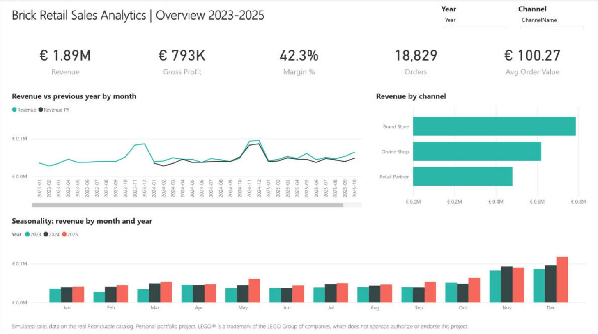
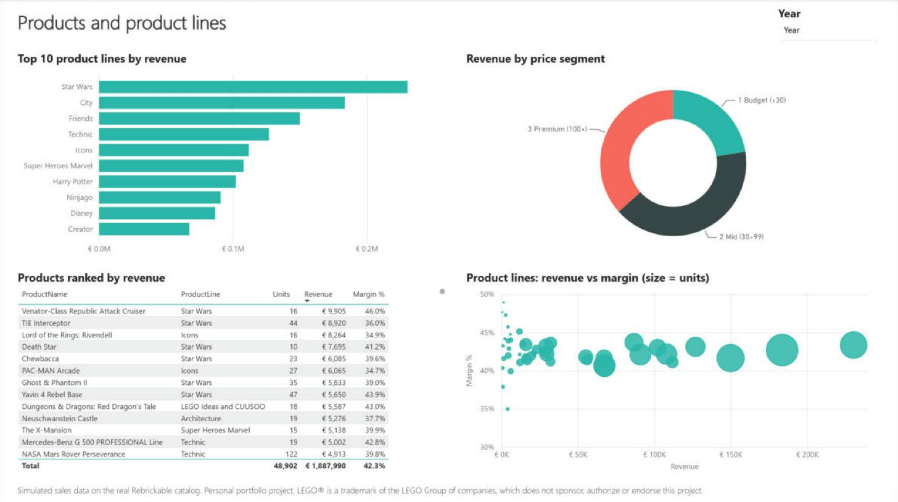
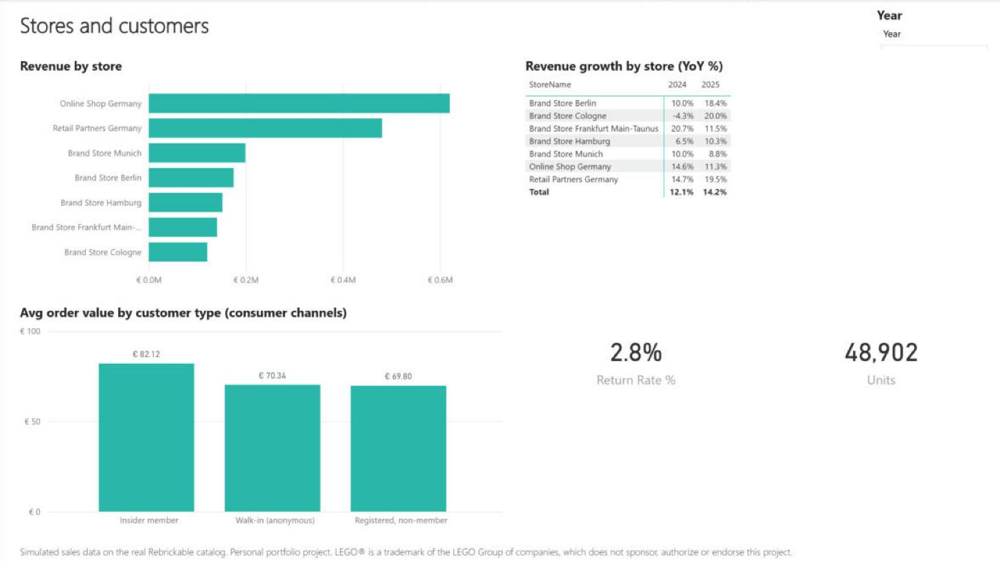

# Brick Retail Sales Analytics (SQL Server + Power BI)

Sales analytics for a fictional German toy retailer selling LEGO® sets.

A personal, non-commercial portfolio project. LEGO® is a trademark of the LEGO Group of companies, which does not sponsor, authorize or endorse this project. No LEGO® logos, images or internal company data are used.
Catalog data comes from [Rebrickable](https://rebrickable.com/downloads/); all commercial data (prices, costs, stores, customers, orders) is simulated.

## Dashboard



| Products | Stores and customers |
|---|---|
|  |  |

## Business problem
A fictional German retailer of LEGO® sets sells through 5 brand stores, an online shop and retail partners. Management wants to know:

1. How are revenue and margin developing, and which channel drives them?
2. Which product lines and sets sell best, and which are growing?
3. How strong is the Christmas season, and how much do discounts cost?
4. Are loyalty (Insider) members worth more than other customers?
5. Where are the growth opportunities?

The project answers these questions in T-SQL, step by step from basic SELECT to window functions, and presents the results in a Power BI dashboard.

## Key findings (simulated data, completed orders 2023 to 2025)

| Topic | Finding |
|---|---|
| Growth | Revenue of 1.89 M EUR; +12.1 % in 2024 and +14.2 % in 2025 |
| Channels | Brand stores 41.7 % of revenue, online shop 32.8 %, retail partners 25.5 % |
| Margin | Own channels earn about 46 % gross margin; retail partners only 30 % because of the 25 % wholesale discount |
| Seasonality | Q4 brings 38 to 40 % of yearly revenue; November and December are the peak months |
| Product lines | Star Wars is the largest line (230 k EUR); among large lines, Icons grew fastest in 2025 (+45 %) |
| Price mix | Premium sets (100 EUR and more) are 9 % of units but 37 % of revenue |
| Loyalty | Insider members spend 82 EUR per order vs 70 EUR for other account holders (+18 %) |
| Retention | 1,855 customers bought in both 2024 and 2025 |
| Data quality | 167 duplicate order lines removed, 33 products without cost, 25 customers without city |

## Data: real vs simulated

| Table | Rows | Source |
|---|---|---|
| Themes | 496 | Real (Rebrickable `themes.csv`), parent/child hierarchy |
| Products | 3,390 | Real catalog (sets 2018 to 2025, at least 50 pieces, retail lines only) + simulated price and cost |
| Channels, Stores | 3, 7 | Simulated |
| Customers | 4,000 | Simulated, anonymous codes only |
| Orders | 19,371 | Simulated, 2023 to 2025 |
| OrderItems | 33,494 raw / 33,327 after cleaning | Simulated |

### Simulation rules (fixed random seeds, see `tools/`)
- **ProductLine** = top-level theme of the set (verified with a recursive CTE, query A4).
- **UnitPrice** = pieces x price per piece, rounded up to x.99, between 9.99 and 899.99 EUR. Price per piece: 0.10 own themes, 0.13 licensed themes, 0.20 Duplo.
- **UnitCost** = 45 to 60 % of UnitPrice; 1 % of products have no confirmed cost (NULL).
- **Orders**: daily volume with yearly growth (+9 %, +19 % vs 2023), monthly seasonality with a Christmas peak, a Black Friday week, busy Saturdays, brand stores closed on Sundays.
- **Products sold** are released in the order year or up to two years before; new releases and big franchises sell more; seasonal sets sell mainly in Q4.
- **Channels**: retail partner orders are bulk orders at a 25 % wholesale discount; consumer orders get 10 or 20 % discounts occasionally and more often in Black Friday week.
- **Customers**: online orders always have a customer account; 55 % of store orders are linked to a customer; Insider members shop more often and buy more per visit.
- **Deliberate data-quality issues**: duplicate order lines, missing cost, missing city, 3 % returned orders.

## Schema
```
Themes (ThemeID PK, ThemeName, ParentThemeID FK -> Themes)
  1 ──< Products (SetNum PK, ProductName, ReleaseYear, ThemeID FK, ProductLine,
                  NumParts, IsLicensed, UnitPrice, UnitCost)
                    1 ──< OrderItems (OrderItemID PK, OrderID FK, SetNum FK,
                                      Quantity, UnitPrice, DiscountPct)
Channels (ChannelID PK) 1 ──< Stores (StoreID PK, ChannelID FK)
  1 ──< Orders (OrderID PK, OrderDate, StoreID FK, CustomerID FK NULL, OrderStatus) 1 ──< OrderItems
Customers (CustomerID PK, CustomerCode, City, IsInsider, SignupDate) 1 ──< Orders
```
Constraints: primary and foreign keys, CHECK (price > 0, cost < price, quantity > 0, discount 0 to 1, valid status), DEFAULT values, indexes on foreign keys and dates, and a UNIQUE key on (OrderID, SetNum) added after cleaning.

Views: `vw_SalesLines` (one flat row per order line with revenue, cost and profit) and `vw_MonthlySales`.

## Files and how to run (SSMS, SQL Server 2016 or later)

| File | Content |
|---|---|
| `01_schema.sql` | Creates database `LegoSalesAnalytics` and all tables |
| `02_load_catalog.sql` | Loads themes, products, channels, stores |
| `03_stage1_select.sql` | **Stage 1**: SELECT, aliases, arithmetic, DISTINCT, TOP, ORDER BY, WHERE |
| `04_load_sales.sql` | Loads customers, orders, order items (about 1 to 2 minutes) |
| `05_data_quality.sql` | Profiling, NULL checks, duplicate detection and removal, unique key |
| `06_views.sql` | Reporting views for analysis and Power BI |
| `07_stage2_sales.sql` | **Stage 2**: GROUP BY, HAVING, COUNT, SUM, AVG, CASE |
| `08_stage3_advanced.sql` | **Stage 3**: JOINs, self-join, recursive CTE, subqueries, CTEs, window functions |
| `powerbi_guide.md` | **Stage 4**: dashboard build guide with DAX measures |
| `interview_qa.md` | **Stage 5**: interview questions and a 2-minute project pitch |
| `tools/` | Python scripts that generated the load files (reproducible) |

Run the SQL files in order 01 to 08. Every script can be re-run. Each analysis query starts with a comment stating the business question it answers.

## Credits
- Catalog data (themes, sets): [Rebrickable](https://rebrickable.com/downloads/), used under the Rebrickable Terms of Service. Rebrickable® is a trademark of its owner; this project is not affiliated with Rebrickable.
- All prices, costs, stores, customers and orders are simulated and do not represent any real company's data.
- LEGO® is a trademark of the LEGO Group of companies, which does not sponsor, authorize or endorse this project.

## Power BI files (Stage 4)
Folder `powerbi/`:
- `Sales_Dashboard.pbix`: the finished 3-page dashboard (Overview, Products, Stores and customers) with data loaded.
- `Sales_Dashboard.pbip` plus the `.Report` and `.SemanticModel` folders: the same report as a Power BI Project (text files, good for GitHub version control).

Model: one fact view (`dbo.vw_SalesLines`) imported from SQL Server, a DAX `Date` table marked as date table, calculated columns `Price Segment` and `Customer Type` (Insider member, registered non-member, anonymous walk-in, retail partner B2B), and measures for Revenue, Gross Profit, Margin %, Orders, Units, Avg Order Value, Avg Order Value Consumer (excludes B2B bulk orders), Revenue PY, Revenue YoY % (shown only for a single year) and Return Rate %. All revenue measures count completed orders only, matching the SQL queries.
Server name is a parameter (`SqlServer`, default `localhost\SQLEXPRESS`): change it under Transform data > Manage parameters if your instance name differs.
Check values (all years): Revenue 1,887,990 EUR, Gross Profit 792,950 EUR, Orders 18,829, Avg Order Value 100.27 EUR.

## License
Code and documentation: MIT License (see `LICENSE`). Catalog data remains subject to the Rebrickable Terms of Service; trademarks belong to their owners.
